# Diagramas UML - Sistema de Gestión de Proyectos de Grado

Este documento contiene todos los diagramas UML del sistema en formato Mermaid, que pueden ser visualizados directamente en GitHub, editores Markdown compatibles o en [Mermaid Live Editor](https://mermaid.live).

---

## 📊 Diagrama de Casos de Uso

Este diagrama muestra todos los casos de uso del sistema organizados por actor (rol).

```mermaid
graph TB
    subgraph "Actores"
        Estudiante[👨‍🎓 Estudiante]
        Tutor[👨‍🏫 Tutor]
        Revisor[👨‍⚖️ Revisor]
        Administrador[👨‍💼 Administrador]
    end

    subgraph "Casos de Uso - Autenticación"
        UC1[Registrarse]
        UC2[Iniciar Sesión]
        UC3[Cerrar Sesión]
        UC4[Ver Perfil]
    end

    subgraph "Casos de Uso - Estudiante"
        UC5[Crear Proyecto]
        UC6[Subir Documento]
        UC7[Ver Observaciones]
        UC8[Comparar Versiones]
        UC9[Ver Bitácoras]
        UC10[Ver Reportes]
        UC11[Descargar Documentos]
        UC12[Marcar Observación Resuelta]
    end

    subgraph "Casos de Uso - Tutor"
        UC13[Ver Proyectos Asignados]
        UC14[Revisar Documento]
        UC15[Agregar Observación]
        UC16[Aprobar Entrega]
        UC17[Rechazar Entrega]
        UC18[Comparar Versiones]
        UC19[Ver Bitácoras]
        UC20[Ver Reportes]
    end

    subgraph "Casos de Uso - Revisor"
        UC21[Ver Proyectos Asignados]
        UC22[Revisar Documento]
        UC23[Agregar Observación]
        UC24[Evaluar Entrega]
        UC25[Comparar Versiones]
        UC26[Ver Bitácoras]
        UC27[Ver Reportes]
    end

    subgraph "Casos de Uso - Administrador"
        UC28[Gestionar Usuarios]
        UC29[Asignar Tutor]
        UC30[Asignar Revisor]
        UC31[Ver Todos los Proyectos]
        UC32[Ver Estadísticas]
        UC33[Ver Todas las Bitácoras]
    end

    subgraph "Casos de Uso - Sistema"
        UC34[Generar Notificaciones]
        UC35[Registrar Bitácora]
        UC36[Comparar Documentos]
    end

    %% Relaciones Estudiante
    Estudiante --> UC1
    Estudiante --> UC2
    Estudiante --> UC3
    Estudiante --> UC4
    Estudiante --> UC5
    Estudiante --> UC6
    Estudiante --> UC7
    Estudiante --> UC8
    Estudiante --> UC9
    Estudiante --> UC10
    Estudiante --> UC11
    Estudiante --> UC12

    %% Relaciones Tutor
    Tutor --> UC2
    Tutor --> UC3
    Tutor --> UC4
    Tutor --> UC13
    Tutor --> UC14
    Tutor --> UC15
    Tutor --> UC16
    Tutor --> UC17
    Tutor --> UC18
    Tutor --> UC19
    Tutor --> UC20

    %% Relaciones Revisor
    Revisor --> UC2
    Revisor --> UC3
    Revisor --> UC4
    Revisor --> UC21
    Revisor --> UC22
    Revisor --> UC23
    Revisor --> UC24
    Revisor --> UC25
    Revisor --> UC26
    Revisor --> UC27

    %% Relaciones Administrador
    Administrador --> UC2
    Administrador --> UC3
    Administrador --> UC4
    Administrador --> UC28
    Administrador --> UC29
    Administrador --> UC30
    Administrador --> UC31
    Administrador --> UC32
    Administrador --> UC33

    %% Relaciones Sistema (automáticas)
    UC6 -.-> UC34
    UC15 -.-> UC34
    UC23 -.-> UC34
    UC6 -.-> UC35
    UC14 -.-> UC35
    UC22 -.-> UC35
    UC8 -.-> UC36
    UC18 -.-> UC36
    UC25 -.-> UC36

    style Estudiante fill:#e1f5ff
    style Tutor fill:#fff4e1
    style Revisor fill:#ffe1f5
    style Administrador fill:#e1ffe1
```

---

## 🗄️ Diagrama Entidad-Relación (Modelo de Base de Datos)

Este diagrama muestra el modelo completo de la base de datos con todas las relaciones entre entidades.

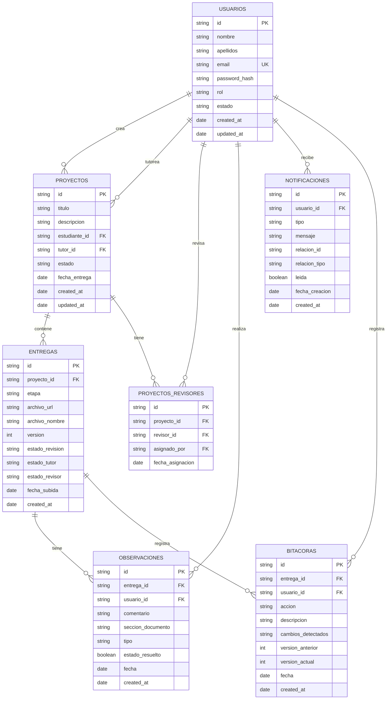

**Nota:** Si el diagrama no se muestra en tu editor, puedes:
1. Copiarlo y pegarlo en [Mermaid Live Editor](https://mermaid.live) - Funciona mejor para diagramas ER
2. Usar un editor que soporte Mermaid como VS Code con la extensión "Markdown Preview Mermaid Support"
3. Verlo directamente en GitHub donde se renderiza automáticamente

**Alternativa:** Si el diagrama ER no funciona, puedes usar el Diagrama de Clases más abajo que muestra la misma información de forma más compatible.

---

## 🔄 Diagrama de Secuencia - Flujo de Subida y Revisión de Documento

Este diagrama muestra el flujo completo cuando un estudiante sube un documento y recibe retroalimentación.

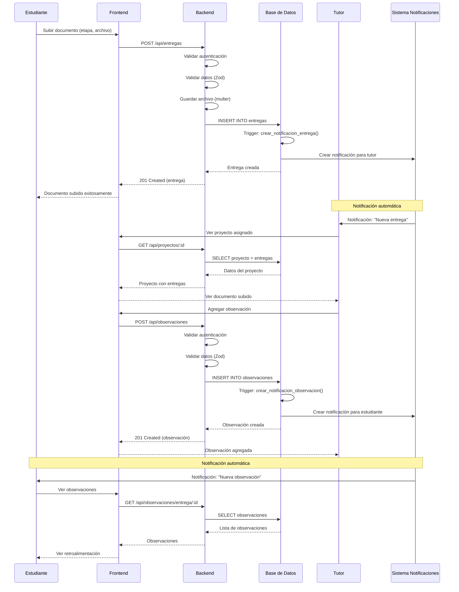

---

## 🏗️ Diagrama de Componentes - Arquitectura del Sistema

Este diagrama muestra la arquitectura de componentes del sistema.

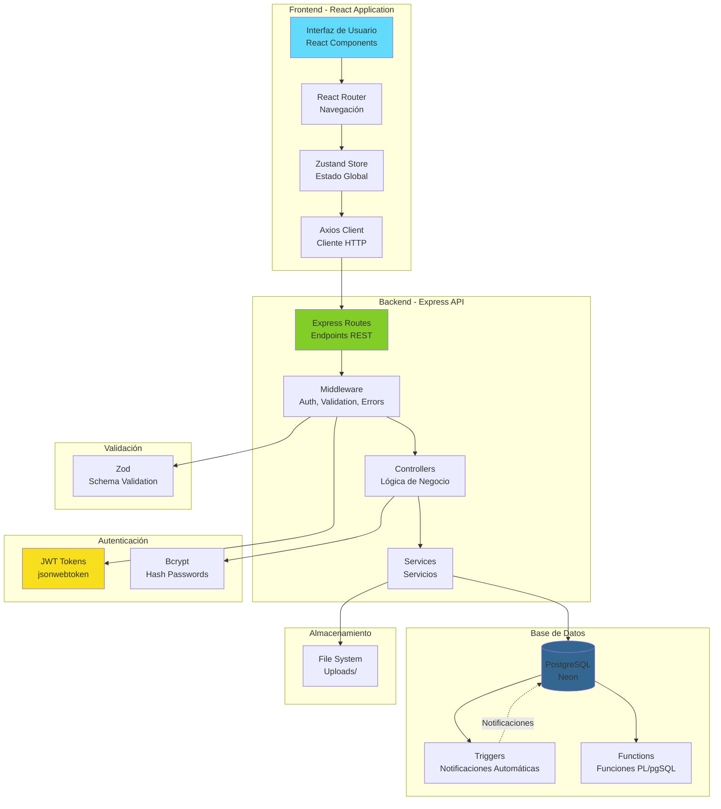

---

## 🔐 Diagrama de Secuencia - Autenticación y Autorización

Este diagrama muestra el flujo completo de autenticación y autorización con JWT.

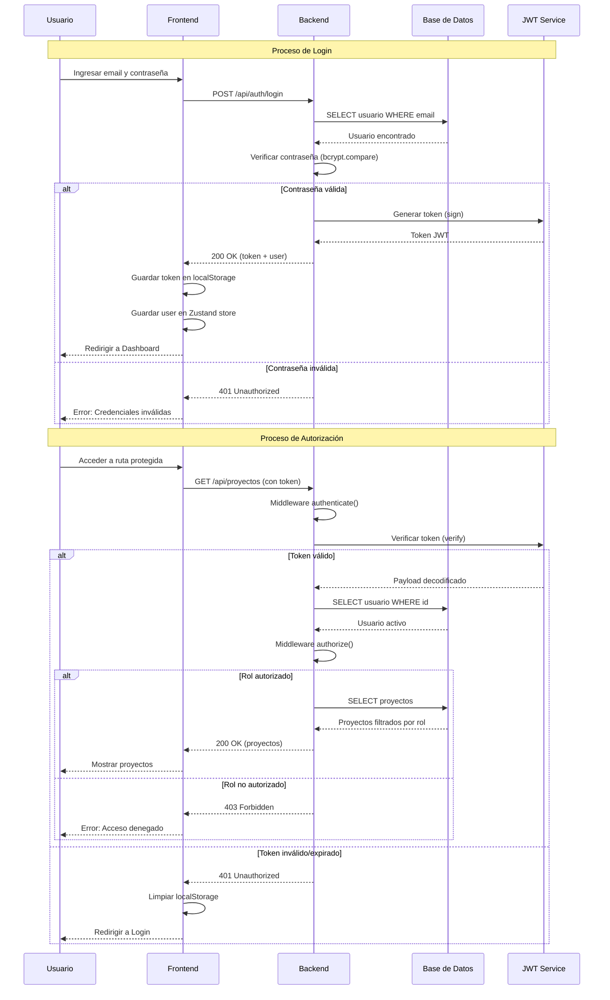

---

## 📈 Diagrama de Estados - Ciclo de Vida de un Proyecto

Este diagrama muestra los estados posibles de un proyecto y las transiciones entre ellos.

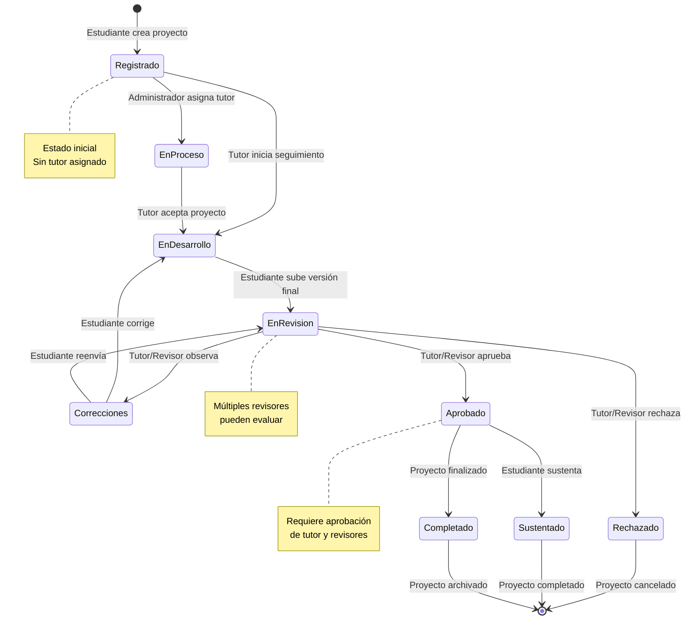

---

## 📦 Diagrama de Clases - Modelo de Datos (Backend)

Este diagrama muestra las clases principales del backend y sus relaciones.

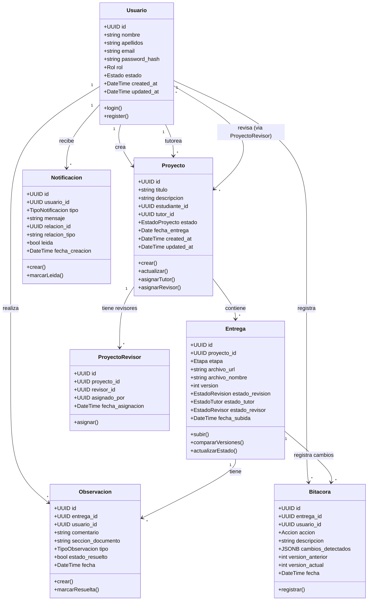

---

## 🔄 Diagrama de Flujo - Proceso de Revisión de Documento

Este diagrama muestra el flujo completo del proceso de revisión de un documento.

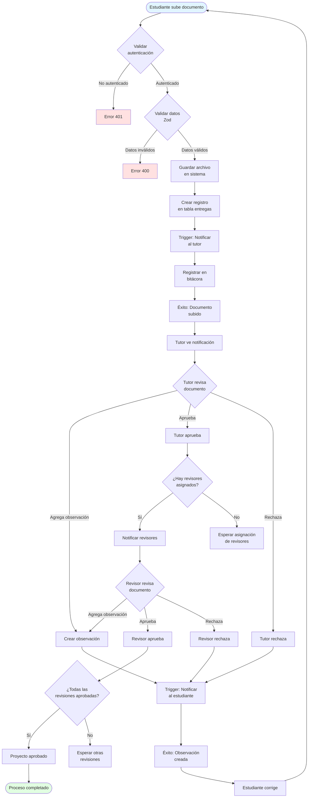

---

## 📱 Diagrama de Despliegue

Este diagrama muestra la arquitectura de despliegue del sistema.

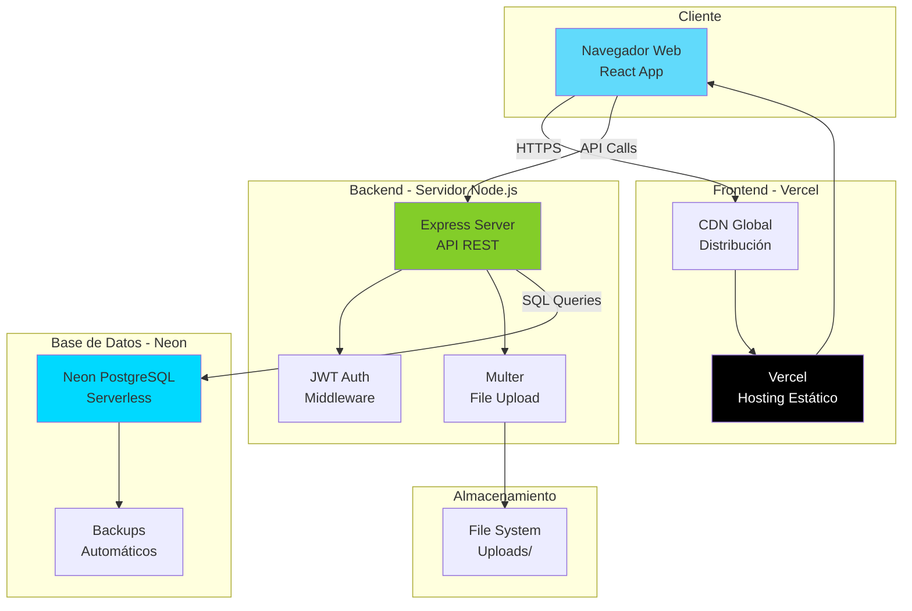

---

## 📝 Notas sobre los Diagramas

### Cómo Visualizar los Diagramas

1. **En GitHub**: Los diagramas Mermaid se renderizan automáticamente en archivos `.md`
2. **En VS Code**: Instala la extensión "Markdown Preview Mermaid Support" o "Mermaid Preview"
3. **En línea**: Copia y pega el código en [Mermaid Live Editor](https://mermaid.live) - **Recomendado para diagramas ER**
4. **En documentación**: Muchos editores Markdown modernos soportan Mermaid

**⚠️ Nota Importante sobre Diagramas ER:** 
Algunos editores tienen problemas con los diagramas ER de Mermaid. Si el diagrama ER no se muestra en tu editor:
- **Solución recomendada**: Copia el código del diagrama ER y pégalo en [Mermaid Live Editor](https://mermaid.live) - tiene el mejor soporte
- **Alternativa**: Usa el Diagrama de Clases más abajo que muestra la misma información de forma más compatible con todos los editores
- **En GitHub**: Los diagramas ER se renderizan correctamente cuando ves el archivo en GitHub

### Convenciones Utilizadas

- **Actores**: Representados con iconos y colores distintivos
- **Entidades**: Nombres en mayúsculas en diagramas ER
- **Relaciones**: Líneas sólidas para relaciones directas, punteadas para automáticas
- **Estados**: Colores diferentes para estados iniciales, intermedios y finales
- **Flujos**: Flechas indican dirección del flujo de datos/control

---

## 🔄 Diagrama de Estados - Gestión de Etapas

Este diagrama muestra los estados posibles de una etapa y sus transiciones válidas.

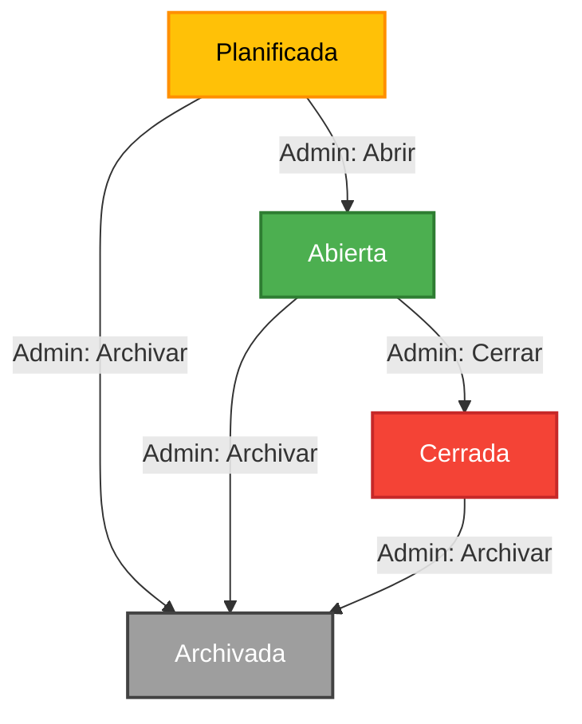

---

## 📅 Diagrama de Flujo - Ciclo de Vida de Etapa

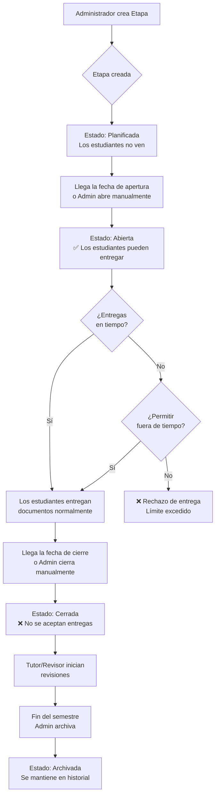

---

## 🏗️ Diagrama de Clases - Entidades de Etapas

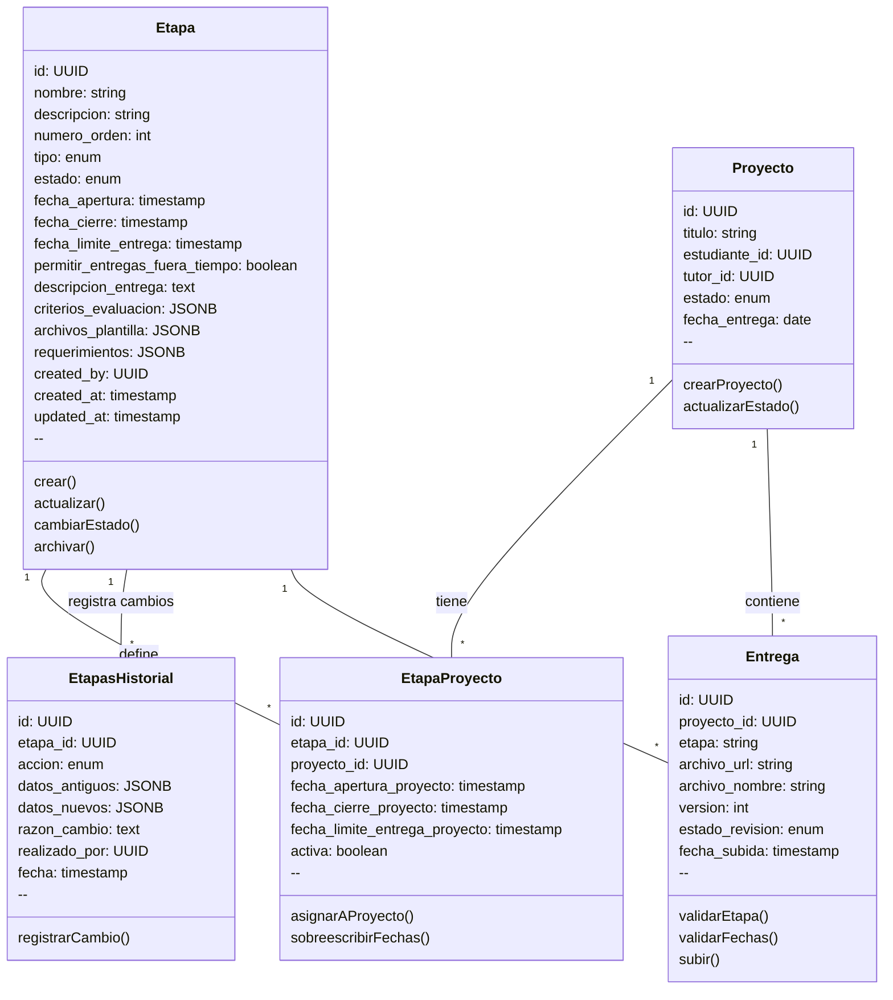

---

## 🔀 Diagrama de Secuencia - Flujo de Entrega con Validación de Etapa

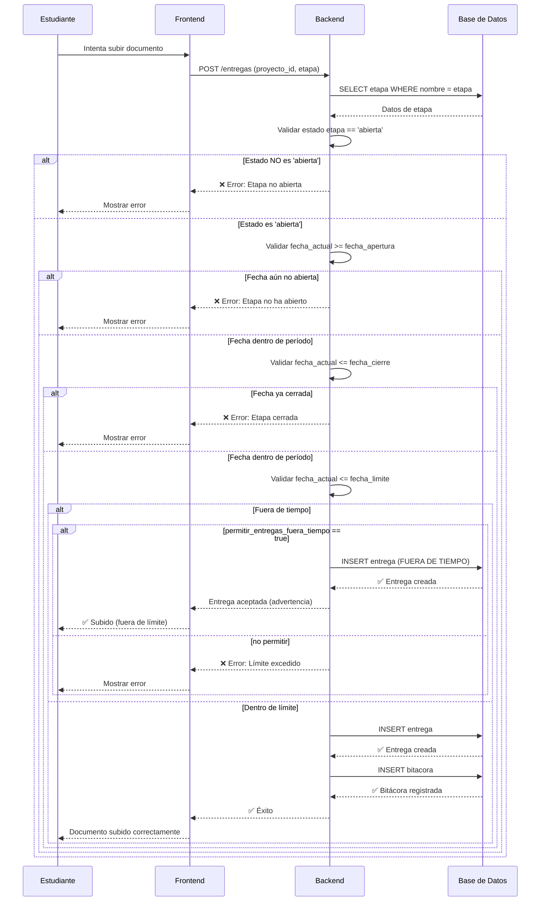

---

## 📊 Diagrama de Casos de Uso - Gestión de Etapas

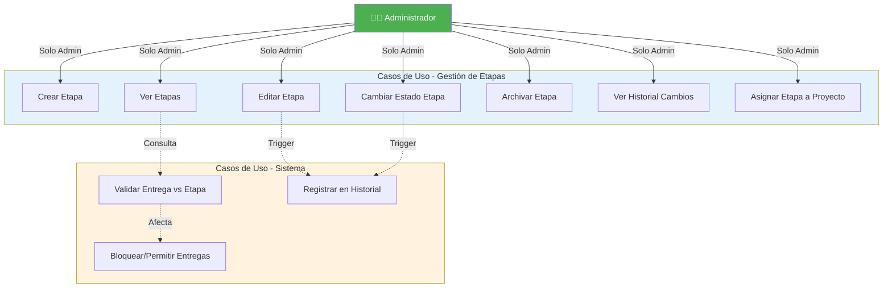

---

### Actualización de Diagramas

Los diagramas deben actualizarse cuando:
- Se agreguen nuevas funcionalidades
- Se modifique el esquema de base de datos
- Se cambien los flujos de usuario
- Se actualice la arquitectura del sistema

---

**Última actualización:** 7 de enero de 2026  
**Versión del Sistema:** 1.1.0  
**Nuevo:** Sistema de Gestión de Etapas

